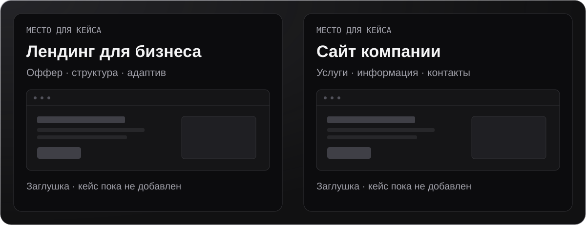
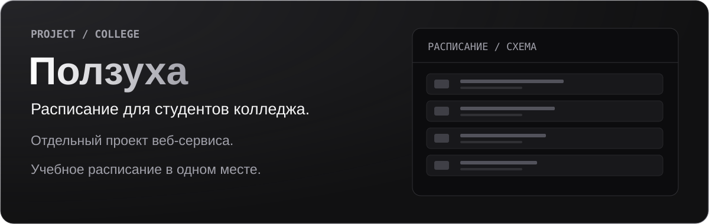

 

  

  

  

  

  

  

<a href="https://t.me/nedanya77">Telegram</a> · <a href="mailto:stennikovdr@gmail.com">Почта</a> · <a href="https://t.me/zavisemiya">Канал</a> · <a href="https://x.com/77Darkblade">X</a> · <a href="https://kwork.ru/user/darkblade">Kwork</a>

