

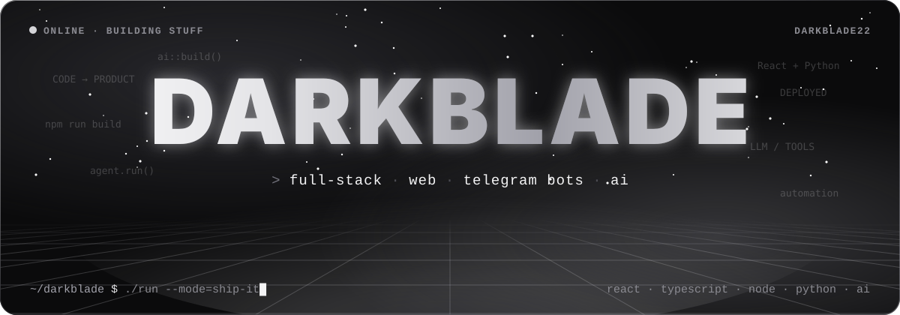

 

<a href="https://t.me/nedanya77">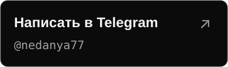</a> <a href="mailto:stennikovdr@gmail.com">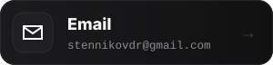</a> <a href="https://t.me/zavisemiya">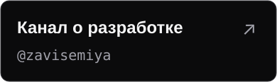</a>

  

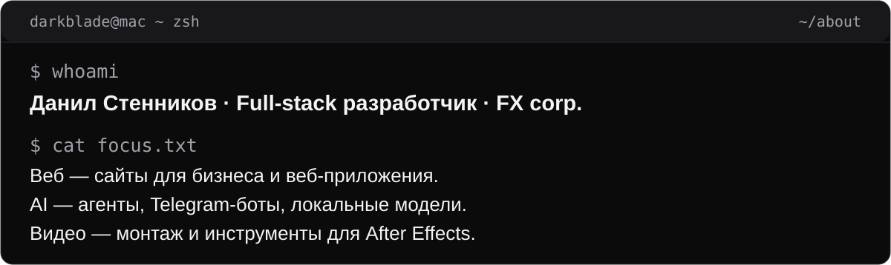

  

<a href="https://github.com/Darkblade22/Ae-assistant">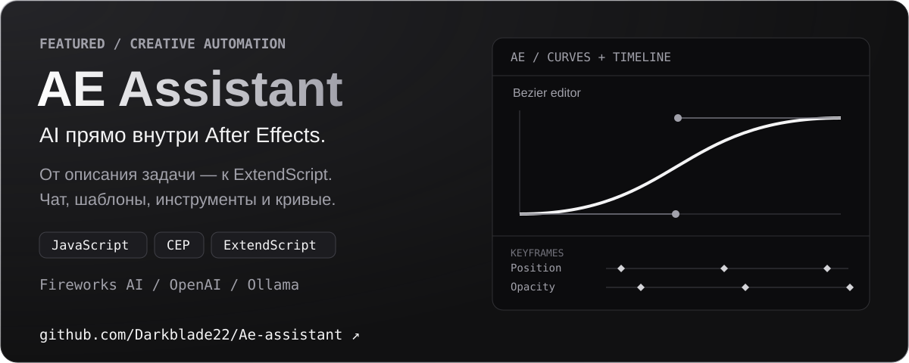</a>

  

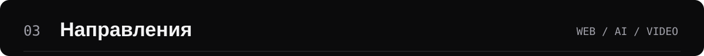
<a href="https://github.com/Darkblade22/AI-TgAgent">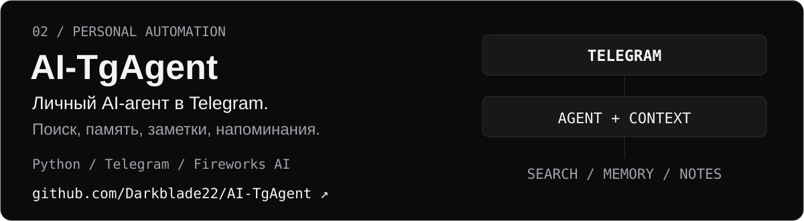</a>

  

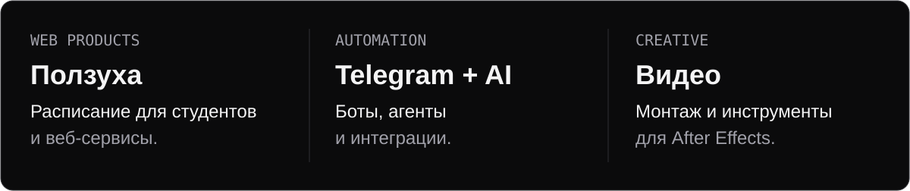

  

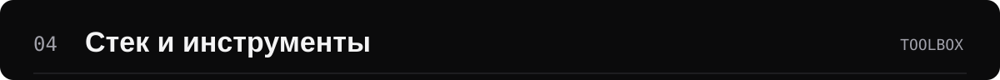
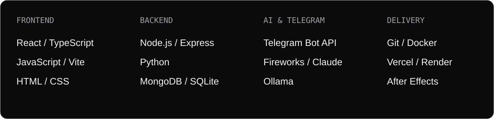

  

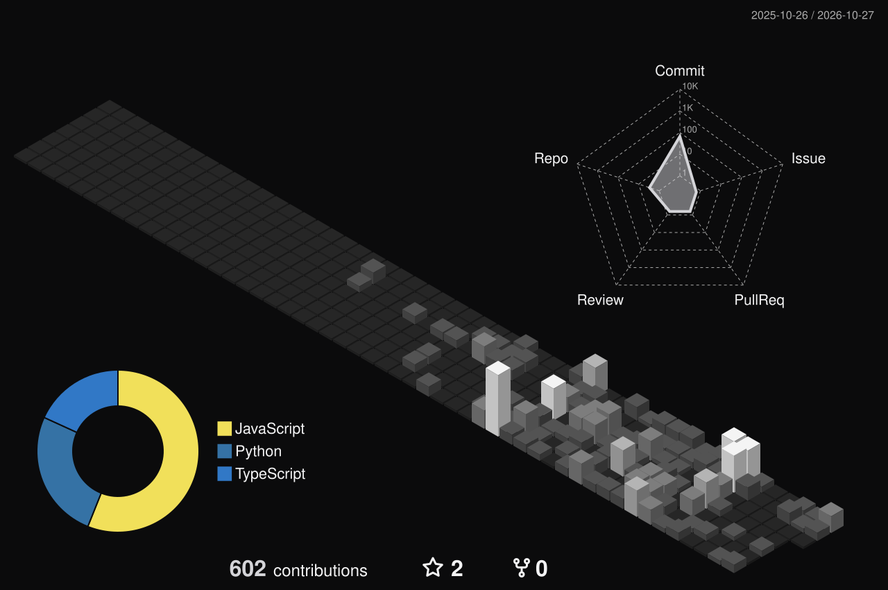

<a href="https://t.me/nedanya77">Telegram</a> · <a href="mailto:stennikovdr@gmail.com">Почта</a> · <a href="https://t.me/zavisemiya">Канал</a> · <a href="https://x.com/77Darkblade">X</a> · <a href="https://kwork.ru/user/darkblade">Kwork</a>

